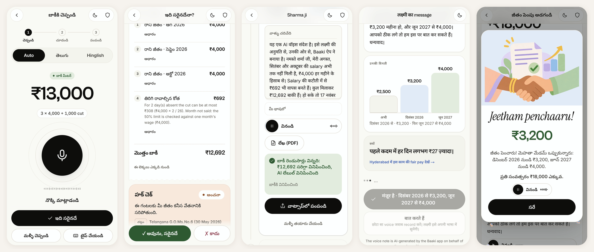
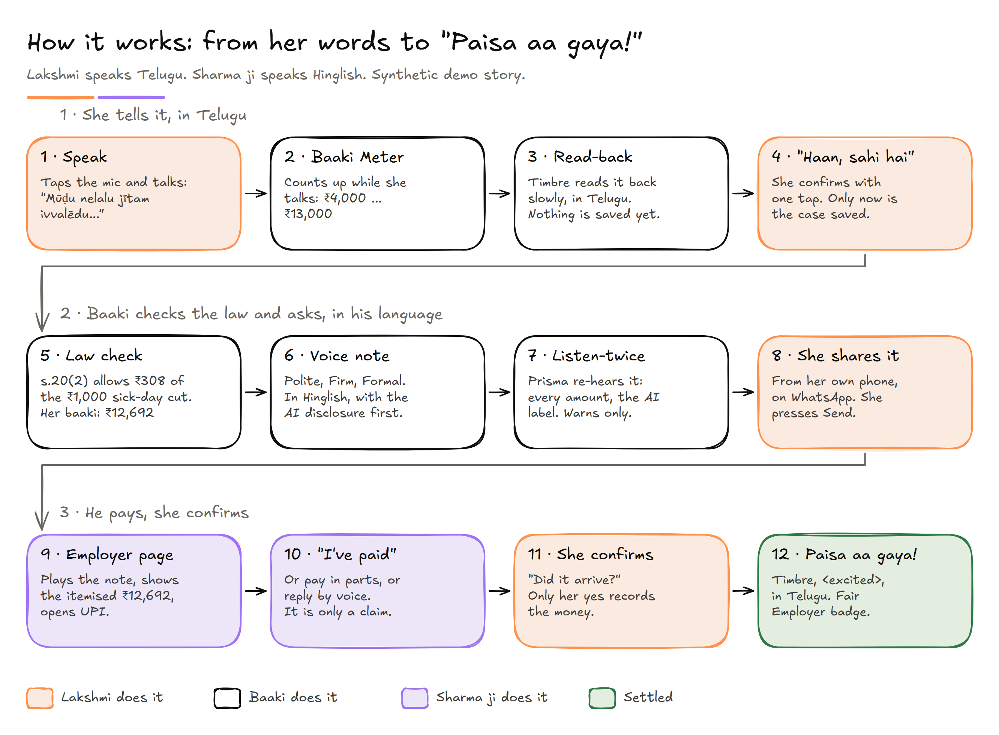
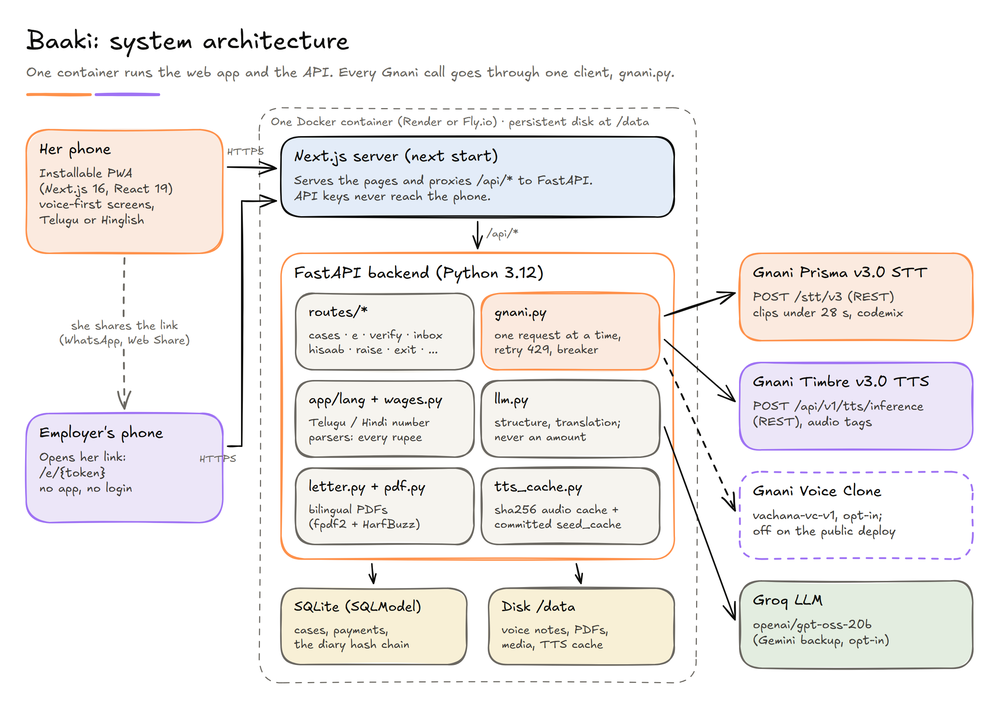
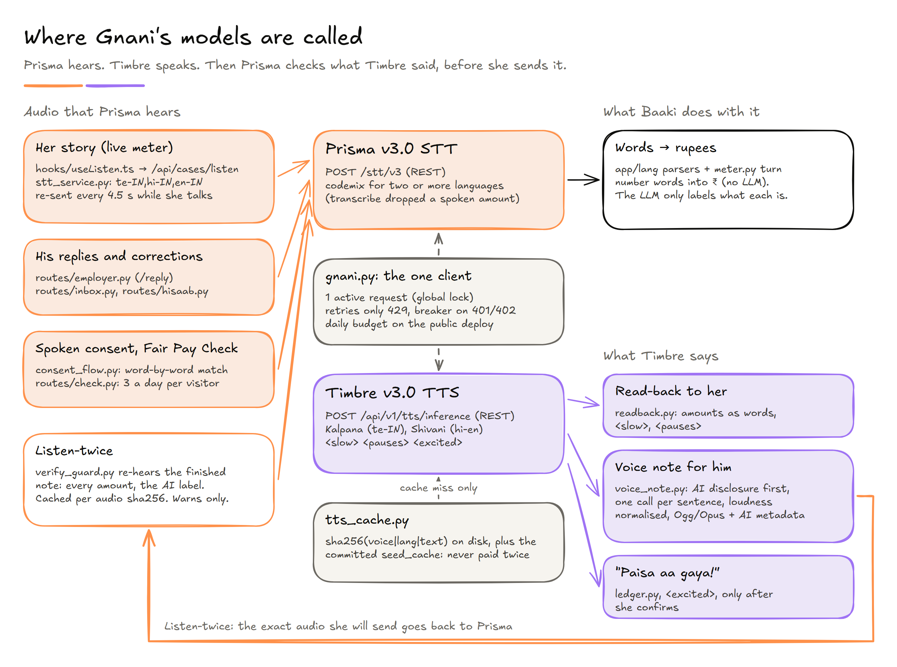
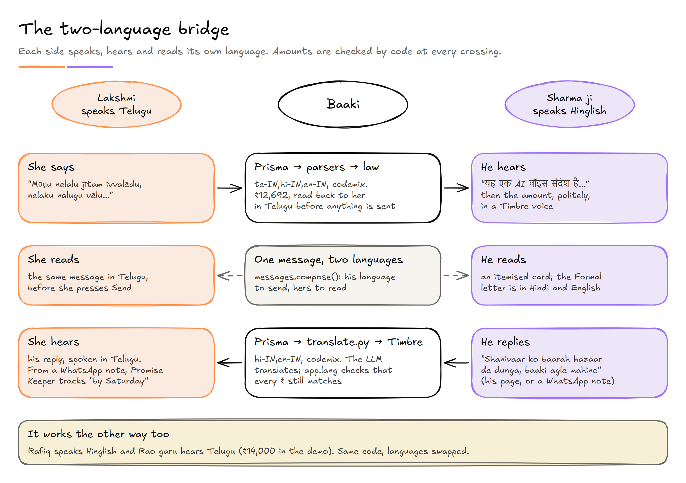
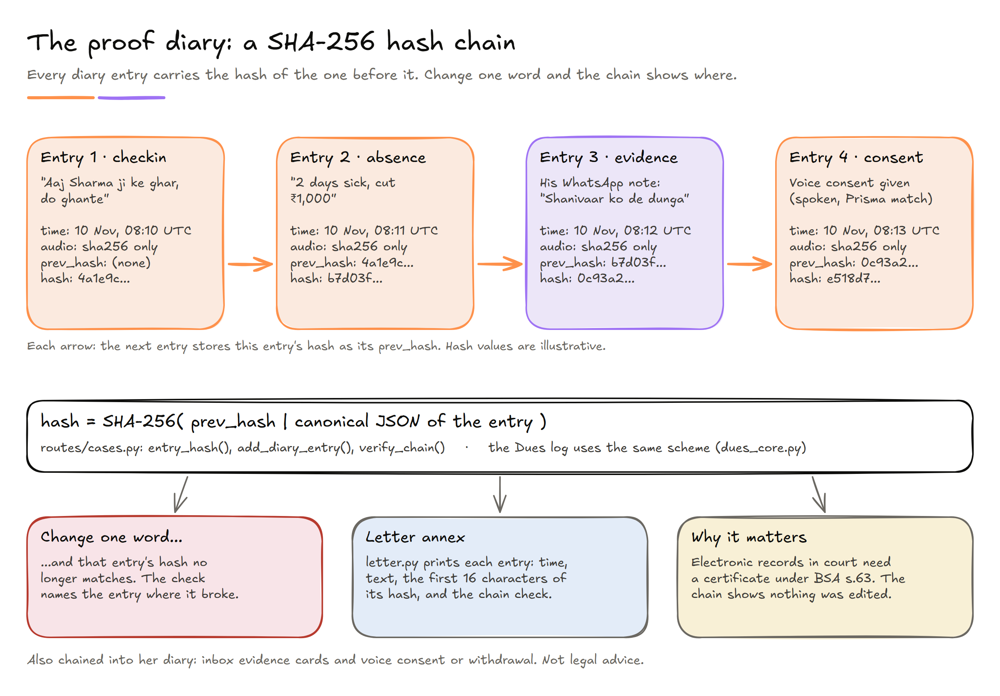

<div align="center">


# Baaki · బాకీ

**A wage advocate in her pocket.**<br>
Voice-first help for Hyderabad's domestic workers to work out unpaid wages and ask for them, in the employer's language.

*"Bolo. Baaki sambhal lega."* (Just speak. Baaki asks.)

[](https://docs.gnani.ai)
[](https://docs.gnani.ai)
[](web/)
[](backend/)
[](backend/tests)
[](#honesty-and-limits)

📄 **Solution pitch:** [PITCH.md](PITCH.md) · [PDF, 1 page](Baaki_Solution_Pitch.pdf) &nbsp;·&nbsp;
🎬 **Demo video:** <!-- VIDEO_URL --> *(link coming)*

</div>


<p align="center"></p>

<p align="center"><sub>Real app screens from the demo (synthetic data). Left to right: she speaks Telugu and the meter shows ₹13,000 · Baaki checks the law (₹12,692, Code on Wages s.20(2)) · the Hinglish voice note, AI-disclosed, heard twice by Prisma · Mehta madam accepts a step-up raise · "Jeetham penchaaru!"</sub></p>

---

## The problem

She can speak. She just can't safely ask. A maid or cook in Hyderabad often has no contract and no payslip. The legal rate is buried in a government PDF. Her employer may speak Hindi while she speaks Telugu.

- **81%** of Hyderabad's domestic workers earned below the state's minimum wage (Montfort Social Institute survey of Hyderabad domestic workers, reported by [Siasat, 27 Aug 2025](https://www.siasat.com/the-silent-domestic-labour-force-in-telangana-is-mostly-invisible-3264044)).
- **6 lakh** domestic workers in Hyderabad alone, by an NGO estimate from the director of Montfort Social Institute ([Siasat, 16 Jun 2025](https://www.siasat.com/we-want-dignity-domestic-workers-protest-for-rights-recognition-in-hyderabad-3234135/)). Officials say no more than 2 lakh ([Deccan Chronicle, 30 Apr 2025](https://www.deccanchronicle.com/southern-states/telangana/domestic-helps-seek-basic-labour-rights-1875894)).
- **61.1%** literacy among rural women in Telangana (PLFS 2023-24, [Telangana Today, 8 Dec 2024](https://telanganatoday.com/rural-literacy-rate-plunges-in-telangana-stands-second-from-bottom-among-all-states)). So Baaki works by voice first.

Telangana promised a Domestic Workers Welfare Act in June 2026 ([Siasat, 16 Jun 2026](https://www.siasat.com/telangana-govt-to-soon-introduce-domestic-workers-welfare-act-3490478/)). It has not been tabled. Until it is, the money she is owed needs one clear number and a polite way to ask.

## How it works

<p align="center"></p>
<p align="center"><sub><a href="docs/architecture/worker-journey.svg">SVG</a> · <a href="docs/architecture/worker-journey.excalidraw">Excalidraw source</a></sub></p>

1. **She speaks.** Lakshmi (fictional, like all demo data) taps the mic and talks in Telugu. The Baaki Meter counts up while she talks: ₹13,000.
2. **Baaki reads it back.** Slowly, in Telugu. Nothing is saved until she says "Haan, sahi hai".
3. **Baaki checks the law.** Sharma ji cut ₹1,000 for two sick days. The Code on Wages, s.20(2), allows ₹308, so her baaki is **₹12,692**. Baaki never asks for more than the law supports.
4. **Baaki asks for her.** A polite voice note in the employer's language (Hinglish here), with an AI disclosure first and an itemised card. Before she shares it, Prisma re-hears the note and checks every amount ("Listen-twice"). She presses Send herself.
5. **He pays, she confirms.** His page plays the note and opens UPI. **"I've paid" is a claim, not a payment.** Baaki asks her to confirm the money arrived. Only her yes records it, settles any instalments, gives the Fair Employer badge and plays "Paisa aa gaya!". One module, `backend/app/ledger.py`, writes every payment and re-derives the case status, badge and plan after each change.

## Built on Gnani.ai

Language is the delivery. Every word she hears and every word she says goes through Gnani's models.

| Gnani model | What Baaki uses it for | Where in the code |
|---|---|---|
| **Prisma v3.0 STT**<br>`POST /stt/v3` (REST) | Her story in one request listing `te-IN,hi-IN,en-IN`, so there is no language picker. `codemix` for every multi-language request (in our test, `transcribe` with two languages dropped a spoken amount). Clips split at pauses under 28 s. While she talks, the audio so far is re-sent every 4.5 s so the meter moves. Also: his voice replies and corrections, the spoken consent check, the Fair Pay Check mic, and **Listen-twice**. | `backend/app/gnani.py`, `stt_service.py`, `routes/cases.py`, `routes/employer.py`, `routes/inbox.py`, `routes/hisaab.py`, `consent_flow.py`, `routes/check.py`, `verify_guard.py`, `web/hooks/useListen.ts` |
| **Timbre v3.0 TTS**<br>`POST /api/v1/tts/inference` (REST) | The read-back with `<slow>` and `<pauses>`. Voice notes in Hinglish or Telugu, the AI disclosure spoken first, one call per sentence. "Paisa aa gaya!" with `<excited>`. Also the consent sentence, the Exit Kit checklist, Hisaab read-backs and his reply spoken in her language. Voices: Kalpana (Telugu), Shivani (Hinglish). | `readback.py`, `voice_note.py`, `tts_cache.py`, `ledger.py`, `consent_text.py`, `exit_kit.py`, `hisaab_core.py` |
| **Voice Clone**<br>embeddings + `vachana-vc-v1` | Opt-in only. Her spoken consent recording is the sample, so the note can be in her own voice. She can withdraw and delete it. Off on the public deploy. Built and covered by tests; tested live against Gnani's API, not yet shown end to end in the demo film. | `gnani.py` (`vc_embedding`, `vc_tts`), `voice_profile.py`, `voice_note.py`, `consent_flow.py` |

All three go through one client, `gnani.py`. It respects the account's one-active-request limit with a global lock, retries only on 429, and opens a breaker on 401/402. A sha256 disk cache means no sentence is ever synthesised twice. Every rupee figure comes from our own Telugu and Hindi number parsers and the wage calculator, never from a language model.

Thank you, **Gnani.ai**, for Prisma and Timbre: Telugu and Hinglish code-mix speech worked well enough to build a product on.

## Architecture

<p align="center"></p>
<p align="center"><sub><a href="docs/architecture/system-architecture.svg">SVG</a> · <a href="docs/architecture/system-architecture.excalidraw">Excalidraw source</a></sub></p>

- **Phone first.** The worker app is an installable PWA (Next.js 16, React 19). The employer needs no app: he opens the link she shares on WhatsApp.
- **Keys stay on the server.** The Next.js server proxies `/api/*` to FastAPI. Gnani and LLM keys never reach the phone.
- **One door to Gnani.** `gnani.py` holds the lock, the retries, the breaker and, on the public deploy, a daily budget per kind and per visitor.
- **Code owns the money.** `app/lang` parses Telugu, Hindi, Hinglish and English amounts. `wages.py` applies G.O.Ms.No.6 and the Code on Wages. The LLM (Groq `openai/gpt-oss-20b`, strict JSON) only labels and translates, and its output is checked against the parsers. `ledger.py` is the only code that records money.
- **One container.** Docker runs FastAPI privately and `next start` publicly. SQLite (SQLModel), voice notes, PDFs and the audio cache live on a disk at `/data`. PDFs use fpdf2 with HarfBuzz shaping and Noto fonts for Telugu and Devanagari.

### The voice pipeline

<p align="center"></p>
<p align="center"><sub><a href="docs/architecture/gnani-voice-pipeline.svg">SVG</a> · <a href="docs/architecture/gnani-voice-pipeline.excalidraw">Excalidraw source</a></sub></p>

Prisma hears, Timbre speaks, and then Prisma checks what Timbre said. Listen-twice transcribes the exact audio she is about to send. It checks that every amount in the message is heard (and nothing else), and that the AI disclosure is heard at the start. It warns on a mismatch and never blocks her. Results are cached per audio hash, so a repeat check costs nothing.

### The two-language bridge

<p align="center"></p>
<p align="center"><sub><a href="docs/architecture/two-language-bridge.svg">SVG</a> · <a href="docs/architecture/two-language-bridge.excalidraw">Excalidraw source</a></sub></p>

Each message is written twice: in his language to send, and in hers so she knows what she is sending. His replies come back through Prisma, a translation step and Timbre, and the amounts are re-checked by code after translation. The demo also runs the other way: Rafiq speaks Hinglish and Rao garu hears Telugu.

### The proof diary

<p align="center"></p>
<p align="center"><sub><a href="docs/architecture/proof-chain.svg">SVG</a> · <a href="docs/architecture/proof-chain.excalidraw">Excalidraw source</a></sub></p>

Her diary check-ins ("Aaj Sharma ji ke ghar, do ghante"), his WhatsApp replies and her voice consent are chained: each entry stores `sha256(prev_hash | canonical JSON of the entry)`. Audio is hashed, not kept. The Formal letter's annex prints each entry with its hash and the chain check, so a later edit shows.

## Features

| Feature | What it does | Route |
|---|---|---|
| **Speak + Baaki Meter** | She talks; the meter counts up live; amount chips she can fix by tap | `/speak` → `/case/new` |
| **Read-back** | Timbre reads the facts back slowly in her language; nothing is saved until she confirms | `/case/new` |
| **Polite → Firm → Formal** | Voice notes and an itemised card in his language; a bilingual demand letter PDF at the Formal step | `/case/{id}` |
| **Listen-twice** | Prisma re-hears each voice note before she shares it: every amount, the AI label | `/case/{id}` |
| **Employer page** | Plays the note, itemised dues, UPI, "I've paid", pay in parts, reply by voice. Link previews show no name or amount | `/e/{token}` |
| **"I've paid" claims** | His tap becomes a claim; only her confirmation records money and plays "Paisa aa gaya!" | `/e/{token}`, `/case/{id}` |
| **Hisaab Milao** | He says or types what he thinks he paid; Baaki proposes a correction; she accepts or disputes it | `/hisaab/{caseId}`, `/hisaab/e/{token}` |
| **Haq Raise** | Asks for a raise to the legal minimum with a step-up plan; he can accept on his page | `/raise/{caseId}`, `/raise/e/{token}` |
| **Promise Keeper** | She adds his WhatsApp voice note or text; Baaki translates it, saves a chained evidence card and tracks his promised date | `/inbox/{caseId}` |
| **Exit Kit** | If she is let go: the date her final dues fall due (s.17(2)), part-month pay, a spoken checklist | `/exit?case={id}` |
| **Other dues** | The milkman's bill, chit money: items, promises kept or broken, polite reminders | `/dues` |
| **Case Replay** | One case's stored events as a timeline with real timestamps and the running balance | `/story/{id}` |
| **Proof diary** | Voice or text check-ins, SHA-256 hash-chained | `/diary` |
| **Spoken consent + voice** | She repeats the consent sentence; Prisma checks it word by word (tap fallback logged); opt-in voice clone | `/voice/consent?worker={id}`, `/voice` |
| **Fair Pay Check** | Employers check their own pay against Telangana's minimum wage in 30 seconds; stores nothing | `/check` |
| **Fair or Not** | Five myth cards for employers, in English, Hinglish and Telugu; stores nothing | `/quiz` |
| **Be Sharma ji** | Play the employer in a fresh synthetic copy of the story; cached audio only, UPI off, expires in 1 hour | `/try/employer` |
| **Noise proof** | Every bench clip playable, hits and misses shown | `/proof` |
| **Safety switch** | Words about being locked in, beaten, an ID taken or a child working stop the flow and show 181, 112, 1098; quick exit | `/safety`, `/r` |
| **Home and website** | Her homes and what each owes; the public site | `/app`, `/` |

## Proof

> In a small noise test, Baaki read **34 of 34 rupee amounts exactly** across 24 noisy clips: a synthetic kitchen as loud as the voice, and kitchen noise, a phone line and WhatsApp compression all at once (17 of 17 in that hardest condition).
>
> *Caveat: stock Gnani voices, a synthetic kitchen, 12 sentences (6 Telugu, 6 Hinglish), run once. A small test, not an accuracy rate.* There were 23 word slips (for example "పండగ" heard as "అండగా"), none in an amount.

Results: [`backend/seed_cache/bench/results.json`](backend/seed_cache/bench/results.json). Every clip plays on the `/proof` page. The bench is `backend/app/proof_bench.py` with `backend/scripts/bench_noisy.py`.

## Honesty and limits

- **Synthetic demo data only.** Lakshmi, Sharma ji, Rafiq, Rao garu, their amounts and UPI IDs are fictional.
- **Not legal advice.** Baaki shows the calculation and its source: G.O.Ms.No.6 (30 May 2026, in force from 1 June 2026) and the Code on Wages, 2019 (s.17 due dates, s.18 to s.20 deductions). It adds no penalties, multiples, interest or predicted outcomes. The last step points to the Telangana Labour Department, NALSA (15100) and India Labourline (1800 833 9020).
- **Estimates are labelled.** The order lists monthly full-time rates only. Part-time and hourly figures are our working-out (monthly ÷ 26 days ÷ 8 hours) and always say "estimate".
- **AI disclosure, every time.** Every voice note starts with a spoken AI disclosure, and the audio file carries an AI label in its metadata. She confirms the read-back and presses Send herself.
- **Code owns the numbers.** No rupee figure comes from a language model.
- **Coverage is debated.** Whether a single household counts as an employer under the Code on Wages is legally contested. Baaki frames each step as a request with a referral, not a legal claim.

## Run it locally

Needs Python 3.12 and Node 22, keys in `.env` at the project root (copy `.env.example`), and a one-time install:

```powershell
cd backend; python -m venv .venv; .venv\Scripts\python -m pip install -r requirements.txt; cd ..
cd web; npm ci; cd ..
```

Then:

```powershell
powershell -ExecutionPolicy Bypass -File scripts\start-demo.ps1   # backend :8020, production web :3020, fresh demo story
powershell -ExecutionPolicy Bypass -File scripts\stop-demo.ps1    # stops only what start-demo started
```

`start-demo.ps1` starts the backend on `127.0.0.1:8020`, builds the web app with `BACKEND_URL=http://127.0.0.1:8020` (skipped when the build is newer than the sources; `-NoBuild` skips it, `-Rebuild` forces it), runs `next start -p 3020`, calls `POST /api/demo/reset` (plus the Haq Raise and dues demos) and prints the URLs: the seeded employer link, the case, Case Replay, Hisaab Milao (both sides), Haq Raise (both sides), the inbox, the Exit Kit, voice consent, `/quiz` and `/try/employer`. Logs and PIDs go to the temp folder the script prints at start (`baaki-demo-*.log`, `baaki-demo-pids.json`). Options: `-NoInterim` (the meter updates only after she stops: fewer STT calls), `-SiteUrl https://...` (the public origin used in link previews and in the links Baaki writes). If `BAAKI_ADMIN_TOKEN` is set in the shell, it is sent on the demo resets (needed only when `BAAKI_PUBLIC=1`).

Filming morning, with the demo running:

```powershell
powershell -ExecutionPolicy Bypass -File scripts\warm-demo.ps1    # re-warms the voice clips, then resets the story
```

The Polite note says a reply-by date (today + 7 days), so that one sentence is new each day (1 Timbre call). The other demo clips (the rest of the Polite note, the read-back, "Paisa aa gaya") are pre-rendered in `backend/seed_cache` (`demo_manifest.json`), so a cold start spends nothing on them. `-Export` copies newly warmed clips into the seed cache; `-Rao` adds the reverse demo's Telugu note; `-LiveConsent` also warms Rafiq's Hinglish consent sentence (a live Timbre call the first time).

**Microphone and HTTPS.** Browsers only allow the mic on `https://` or `localhost`. Either record in desktop Chrome on `http://localhost:3020` with DevTools device mode (phone frame; the mic works on localhost), or use the deployed HTTPS URL (see "Deploy"). The local scripts never expose anything to the internet.

### Development and tests

```powershell
cd backend; .venv\Scripts\python -m uvicorn app.main:app --port 8020 --reload   # API
cd web; $env:BACKEND_URL="http://127.0.0.1:8020"; npm run dev                  # http://localhost:3000
cd backend; .venv\Scripts\python -m pytest -q                                    # 1,643 tests pass, offline (keys blanked)
backend\.venv\Scripts\python backend\scripts\retest_features.py                  # every feature through the API, zero Gnani calls
cd web; npm run build
```

macOS / Linux:

```bash
cd backend && python3.12 -m venv .venv && .venv/bin/pip install -r requirements.txt
.venv/bin/uvicorn app.main:app --port 8020 --reload                 # API, keys from ../.env
cd web && npm ci && BACKEND_URL=http://127.0.0.1:8020 npm run dev    # http://localhost:3000
curl -X POST http://127.0.0.1:8020/api/demo/reset                    # seed the demo story
cd backend && .venv/bin/python -m pytest -q                          # tests, offline
```

`retest_features.py` drives each feature end to end against a throwaway database (`BAAKI_RETEST_DIR`, default the system temp folder) with every key blanked, and exits non-zero if a step fails; `-k raise` runs only matching steps. `GET /health` reports whether the keys are set and the Gnani calls made since start. Gnani API notes: `docs/gnani_api/`. Design system: `docs/DESIGN_SYSTEM.md`. Link-preview image: `node web/scripts/make-og.mjs`. Diagrams: `python docs/architecture/tools/build_diagrams.py`.

### Public mode

Localhost (filming) runs open, as above. `BAAKI_PUBLIC=1` (set by the deploy files) switches on, in `backend/app/security.py`:

- **Worker keys:** a worker's routes need her key (`X-Baaki-Key`); only its sha256 is stored. The seeded synthetic workers stay viewable (`BAAKI_DEMO_OPEN=1`, the default), so visitors can open the demo.
- **Admin token** on the demo resets: `POST /api/demo/reset` needs `X-Admin-Token: $BAAKI_ADMIN_TOKEN`.
- **Gnani budget:** daily caps per kind (`GNANI_BUDGET_STT`, `_TTS`, `_VC`) and per visitor IP (`GNANI_BUDGET_PER_IP`), checked in the one Gnani client; over budget, routes fall back to text. Outside a short list of routes, TTS is cache-only. Cloning is off. `STT_MAX_SECONDS` caps one recording (on localhost too).
- **Client IP** from the platform proxy only with `TRUSTED_PROXY=1`; security headers on every response.

Every setting, with its default, is in `.env.example`.

### Deploy

`Dockerfile` builds the web app (Node 22) and runs both processes in one Python 3.12 image: `start.sh` starts FastAPI on `127.0.0.1:8000` (private), waits for `/health`, then runs `next start` on `0.0.0.0:$PORT`, which proxies `/api/*` to it. The database, media and TTS cache live on a persistent disk at `/data` (`DATABASE_URL=sqlite:////data/app.db`). On first boot, with an empty database, the backend seeds the synthetic demo story itself. `backend/seed_cache` is in the image, so the demo's voice clips and the noise-bench results work on a cold start. Keep one instance: SQLite on one disk.

- **Render:** New → Blueprint → this repo (`render.yaml`: Docker web service, Starter plan, 1 GB disk at `/data`, health check `/api/health`). Fill in `GNANI_API_KEY` and `GROQ_API_KEY` when asked; `BAAKI_ADMIN_TOKEN` is generated. If the service name isn't `baaki`, change `NEXT_PUBLIC_SITE_URL` and `PUBLIC_BASE_URL` to the real URL.
- **Fly.io:** set the app name and both URLs in `fly.toml`, then `fly apps create <name>`, `fly volumes create baaki_data --region bom --size 1`, `fly secrets set GNANI_API_KEY=... GROQ_API_KEY=... BAAKI_ADMIN_TOKEN=...`, `fly deploy` (one machine, always on, health check `/api/health`).
- **Any Docker host:** `docker build -t baaki --build-arg NEXT_PUBLIC_SITE_URL=https://your-host .` then `docker run -p 3000:3000 -v baaki-data:/data -e BAAKI_PUBLIC=1 -e BAAKI_ADMIN_TOKEN=... -e GNANI_API_KEY=... baaki`.

`NEXT_PUBLIC_*` and `BACKEND_URL` are baked in at build time, so change them as build args and rebuild. Reset the deployed demo with `curl -X POST -H "X-Admin-Token: <token>" https://<host>/api/demo/reset`.

## Project structure

```
backend/
  app/
    main.py            FastAPI app, /api/stt, /api/tts, health
    gnani.py           the one Gnani client: Prisma, Timbre, Voice Clone
    stt_service.py     upload -> ffmpeg -> clips under 28 s -> Prisma
    tts_cache.py       sha256 disk cache for Timbre (+ committed seed_cache)
    voice_note.py      employer voice notes: AI disclosure first, Ogg/Opus + AI metadata
    verify_guard.py    Listen-twice
    lang/              Telugu / Hindi / Hinglish / English number, amount and date parsers
    meter.py  extract.py  readback.py  wages.py  ledger.py  messages.py
    letter.py  pdf.py  llm.py  translate.py  security.py
    routes/            cases, employer, letters, verify, inbox, hisaab, raise, exit,
                       dues, check, quiz, story, consent, sandbox, proof
  seed_cache/          pre-rendered demo audio and the noise-bench results
  tests/               pytest, offline
web/
  app/                 Next.js routes: /, /app, /speak, /case, /e, /hisaab, /raise, /inbox, /exit, /dues, ...
  components/  hooks/  lib/
docs/
  architecture/        the diagrams (.excalidraw, .svg, .png) and tools/build_diagrams.py
  research/            problem numbers, law and procedure, Gnani feasibility tests
  gnani_api/           Gnani API notes
Dockerfile  start.sh  render.yaml  fly.toml
```

## Acknowledgements

Thank you to **Gnani.ai** for Prisma and Timbre, and for organising the **Great Indian AI Internship Challenge**. Thanks also to the Hyderabad domestic workers' unions, researchers and reporters whose work is cited above.

## Author

Built by [@Maheswar-Sah00](https://github.com/Maheswar-Sah00).
